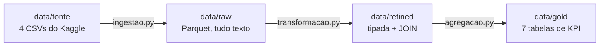

# Pipeline Pizzaria

Pipeline de dados em Python que transforma um ano de vendas de uma pizzaria em indicadores de negócio (KPIs), organizado em três camadas: **raw → refined → gold**.

Projeto do **Desafio Final – Engenheiro de Dados Júnior** da Aceleração EmpregaDados (Instituto NTA). Ele replica a lógica do *Pipeline Olist* visto em aula, usando outro dataset.

## Objetivo

Responder perguntas de negócio de uma pizzaria a partir dos dados brutos de pedidos:

- Quanto a pizzaria faturou no ano e qual é o ticket médio?
- Como o faturamento evolui mês a mês?
- Quais categorias, pizzas e tamanhos vendem mais?
- Em que horários e dias da semana estão os picos de pedidos?

## Dataset

| | |
|---|---|
| **Nome** | Pizza Place Sales |
| **Fonte** | [Kaggle – mysarahmadbhat/pizza-place-sales](https://www.kaggle.com/datasets/mysarahmadbhat/pizza-place-sales) |
| **Licença** | CC0: Public Domain |
| **Período** | 01/01/2015 a 31/12/2015 |

| Arquivo | Linhas | Conteúdo |
|---|---|---|
| `orders.csv` | 21.350 | pedido, data e hora |
| `order_details.csv` | 48.620 | itens de cada pedido (pizza e quantidade) |
| `pizzas.csv` | 96 | pizza por tamanho, com preço |
| `pizza_types.csv` | 32 | nome, categoria e ingredientes de cada sabor |

Relacionamento: `order_details` → `orders` (por `order_id`) → `pizzas` (por `pizza_id`) → `pizza_types` (por `pizza_type_id`).

> Os dados **não são versionados** no git. Veja em [Como rodar](#como-rodar) onde colocar os CSVs.

## Arquitetura



O `pipeline.py` executa as três etapas em ordem com um único comando.

| Camada | O que faz | Regras |
|---|---|---|
| **raw** | Cópia fiel dos CSVs em Parquet | Todas as colunas como texto (VARCHAR); mesmas linhas e colunas da fonte; nada é limpo ou convertido |
| **refined** | Dados limpos e tipados, com nomes em português | `CAST` com falha explícita (sem `TRY_CAST`); nulo ou chave duplicada **para** o pipeline; JOIN das 4 tabelas em `itens_pedido` sem perder linhas |
| **gold** | Uma tabela por pergunta de negócio | Lê só a refined; cada KPI vem de um arquivo em `sql/gold/<tabela>.sql`; dinheiro em `DECIMAL(10,2)`; os totais de todos os KPIs precisam bater com a refined, senão o pipeline **para** |

Ferramentas: **Python 3.13**, **DuckDB** (SQL e Parquet), **pandas** (leitura dos CSVs), **pytest** e **pytest-cov**, e **Streamlit** para o painel.

### Decisões de dados

- **Encoding:** `pizza_types.csv` não é UTF-8. Ele tem uma aspa `‘` do Windows-1252 em "‘Nduja Salami". O arquivo é lido como `cp1252` e gravado em UTF-8, mantendo o caractere original.
- **Data e hora** ficam em colunas separadas (`DATE` e `TIME`), para facilitar os KPIs por mês e por hora.
- **Preço** é `DECIMAL(10,2)`, e não `DOUBLE`, para as somas de dinheiro serem exatas.
- **Valores da fonte** (`Classic`, `S`, `M`…) são mantidos; só os nomes das colunas foram traduzidos.
- **Qualidade:** a base não tem nulos, duplicados nem itens órfãos. As validações existem para que uma carga futura com problema pare o pipeline, em vez de gerar números errados em silêncio.

## O que é uma linha de cada tabela

**raw** (`data/raw/`): cada arquivo tem as mesmas linhas da fonte.

| Tabela | 1 linha = |
|---|---|
| `orders` | 1 pedido |
| `order_details` | 1 item de um pedido: um sabor num tamanho, com a quantidade pedida |
| `pizzas` | 1 sabor num tamanho, com o preço |
| `pizza_types` | 1 sabor, com nome, categoria e ingredientes |

**refined** (`data/refined/`):

| Tabela | 1 linha = | Colunas |
|---|---|---|
| `pedidos` | 1 pedido | `id_pedido`, `data`, `hora` |
| `detalhes_pedido` | 1 item de um pedido | `id_detalhe`, `id_pedido`, `id_pizza`, `quantidade` |
| `pizzas` | 1 sabor num tamanho | `id_pizza`, `id_tipo_pizza`, `tamanho`, `preco` |
| `tipos_pizza` | 1 sabor | `id_tipo_pizza`, `nome`, `categoria`, `ingredientes` |
| `itens_pedido` | 1 item de um pedido, com os dados das 4 tabelas acima juntados por JOIN. É a única tabela que a gold lê | `id_detalhe`, `id_pedido`, `data`, `hora`, `id_pizza`, `id_tipo_pizza`, `nome_pizza`, `categoria`, `tamanho`, `quantidade`, `preco`, `valor_item` (= `quantidade × preco`) |

**gold** (`data/gold/`): o SQL de cada tabela está em `sql/gold/<tabela>.sql`.

| Tabela | 1 linha = |
|---|---|
| `resumo_geral` | o ano inteiro (a tabela tem só 1 linha) |
| `vendas_mensais` | 1 mês |
| `vendas_por_categoria` | 1 categoria |
| `ranking_pizzas` | 1 sabor, com todos os tamanhos somados |
| `vendas_por_tamanho` | 1 tamanho (S, M, L, XL, XXL) |
| `pedidos_por_hora` | 1 hora do dia em que houve pedido |
| `pedidos_por_dia_semana` | 1 dia da semana |

## Estrutura de pastas

```
pipeline-pizzaria/
├── data/
│   ├── fonte/            CSVs originais do Kaggle (fora do git)
│   ├── raw/              Parquet espelho da fonte (fora do git)
│   ├── refined/          Parquet tipado (fora do git)
│   └── gold/             Parquet de KPIs (fora do git)
├── sql/
│   └── gold/             um .sql por KPI (resumo_geral.sql, vendas_mensais.sql, ...)
├── src/
│   ├── config.py         caminhos, tabelas da fonte e lista de KPIs
│   ├── ingestao.py       fonte -> raw
│   ├── transformacao.py  raw -> refined (tipagem, validações, JOIN)
│   ├── agregacao.py      refined -> gold (roda os .sql e valida os totais)
│   ├── pipeline.py       orquestra tudo, com logging
│   └── leitura_gold.py   leitura da gold e formatação para o painel
├── painel/
│   └── app.py            dashboard Streamlit
├── tests/
│   ├── test_ingestao.py
│   ├── test_transformacao.py
│   ├── test_agregacao.py
│   ├── test_pipeline.py
│   └── test_leitura_gold.py
├── pytest.ini            configuração dos testes e da cobertura
├── requirements.txt
└── README.md
```

## Como instalar

Pré-requisito: Python 3.13 ou superior.

```powershell
git clone https://github.com/BigPedro86/pipeline-pizzaria.git
cd pipeline-pizzaria
python -m venv .venv
.\.venv\Scripts\Activate.ps1
pip install -r requirements.txt
```

> No Linux ou macOS, ative o ambiente com `source .venv/bin/activate`.
> Se o Windows bloquear o `Activate.ps1`, use `.\.venv\Scripts\python.exe` no lugar de `python` nos comandos.

## Como rodar

1. Baixe o dataset no [Kaggle](https://www.kaggle.com/datasets/mysarahmadbhat/pizza-place-sales) e coloque os 4 CSVs em `data/fonte/`. Não abra os arquivos no Excel antes, porque ele altera datas e números ao salvar.
2. Rode o pipeline completo com um único comando:

```powershell
python -m src.pipeline
```

Saída esperada (resumida):

```
2026-11-05 22:58:12 | INFO | Início: ingestão (fonte -> raw)
2026-11-05 22:58:12 | INFO |   orders: 21.350 linhas
...
2026-11-05 22:58:13 | INFO |   itens_pedido: 48.620 linhas
...
2026-11-05 22:58:13 | INFO | Pipeline concluído em 0.48 s
```

Se alguma etapa falhar, o erro aparece no log com nível `ERROR`, as etapas seguintes não rodam e o comando termina com código de saída 1.

Também é possível rodar uma etapa isolada: `python -m src.ingestao`, `python -m src.transformacao` ou `python -m src.agregacao`.

## Painel (Streamlit)

Depois de rodar o pipeline, abra o painel:

```powershell
streamlit run painel/app.py
```

O painel abre no navegador, em `http://localhost:8501`, e lê **só a camada gold**. Ele mostra:

- os cartões do ano: faturamento, pedidos, ticket médio e pizzas por pedido;
- o faturamento mês a mês;
- o faturamento por categoria e por tamanho;
- o top 5 e o bottom 5 de pizzas, por faturamento ou por unidades;
- os picos de pedidos por hora e a média por dia da semana.

Cada gráfico tem tooltip e um botão **"Ver tabela"** com os números. Se a gold ainda não existir, o painel avisa que é preciso rodar o pipeline antes.

## Testes e cobertura

```powershell
python -m pytest
```

O comando roda os 37 testes e mostra a cobertura de cada arquivo no terminal. Também gera o relatório HTML em `htmlcov/index.html` e **falha se a cobertura ficar abaixo de 70%**. A cobertura atual é de **96%**.

Os testes não usam os dados reais. Cada um monta CSVs ou Parquets pequenos numa pasta temporária, com valores calculados à mão, e cobre também os casos de erro: arquivo ausente, coluna trocada, encoding errado, valor inválido, nulo, chave duplicada, JOIN com perda, total de KPI que não fecha e KPI sem arquivo `.sql`.

## KPIs gerados (camada gold)

| Tabela | Pergunta | Resultado com os dados de 2015 |
|---|---|---|
| `resumo_geral` | Quanto vendemos no ano? | **$ 817.860,05** em 21.350 pedidos e 49.574 pizzas; **ticket médio de $ 38,31**; 2,32 pizzas por pedido |
| `vendas_mensais` | Como o faturamento evolui? | Melhor mês: julho ($ 72.557,90). Pior mês: outubro ($ 64.027,60) |
| `vendas_por_categoria` | Qual categoria fatura mais? | Classic 26,9% · Supreme 25,5% · Chicken 24,0% · Veggie 23,7% |
| `ranking_pizzas` | Quais pizzas vendem mais e menos? | Mais faturamento: The Thai Chicken ($ 43.434,25). Mais unidades: The Classic Deluxe (2.453). Menor faturamento: The Brie Carre ($ 11.588,50) |
| `vendas_por_tamanho` | Qual tamanho sai mais? | L 45,9% · M 30,5% · S 21,8% · XL 1,7% · XXL 0,1% |
| `pedidos_por_hora` | Qual é o horário de pico? | 12h (2.520 pedidos) e 13h (2.455); funcionamento das 9h às 23h |
| `pedidos_por_dia_semana` | Qual dia vende mais? | Sexta (70,8 pedidos por dia em média). Domingo é o mais fraco (50,5) |

Definições: faturamento = soma de `quantidade × preço`; ticket médio = faturamento ÷ número de pedidos; a média por dia da semana considera só os dias que tiveram venda (em 2015 houve 7 dias sem venda, entre eles o Natal).

## Uso de IA

Comecei este projeto do zero e usei IA (Claude) durante todo o desenvolvimento. Ela me explicou como montar a estrutura do pipeline em camadas, me ajudou a escrever o código e corrigiu meus erros. A cada correção, explicou o motivo, e isso foi o que mais me ajudou a aprender.

**Onde os erros aconteceram**

- **Transformação (raw → refined):** foi a parte mais difícil para mim. Digitei muito código errado (tipos, `CAST`, nomes de colunas, o JOIN), e a IA apontava o erro e explicava cada situação antes de seguirmos.
- **Checklist final:** a IA conferiu o projeto e disse que todos os requisitos estavam cumpridos. Ela tinha assumido que conhecia os requisitos, mas eu conferi com o enunciado oficial da aula, e faltavam três itens: um arquivo `.sql` por indicador, esta seção sobre IA e a descrição do que é uma linha de cada tabela. Os três foram feitos depois disso. A lição foi que a IA não substitui ler o enunciado.

**Como trabalhei para não aceitar nada sem conferir**

- Fiz uma etapa por vez. Só fazia o commit depois de rodar os testes e o pipeline e de entender o que tinha sido feito.
- As validações do pipeline (nulos, chaves duplicadas, JOIN sem perda e totais dos KPIs batendo com a refined) servem justamente para um erro, meu ou da IA, parar o pipeline em vez de gerar um número errado.

**O que aprendi sobre usar IA:** um prompt bem feito, direto e com o objetivo claro faz muita diferença na qualidade da resposta. E a responsabilidade de entender e defender o código continua sendo minha.

## Próximos passos

- Publicar o painel no Streamlit Community Cloud.
- Gravar o log também em arquivo, para guardar o histórico das execuções.
- Carga incremental: processar só os pedidos novos, em vez de reprocessar o ano inteiro.
- Validações de regra de negócio (por exemplo, preço maior que zero e quantidade entre 1 e 10).
- Rodar os testes automaticamente a cada push com GitHub Actions.

## Autor

Pedro Caio · [github.com/BigPedro86](https://github.com/BigPedro86)
